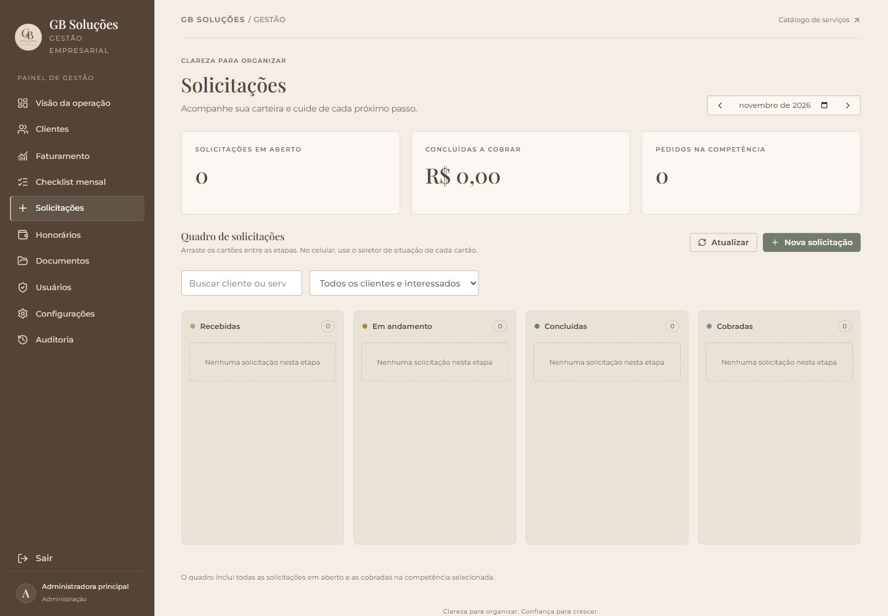
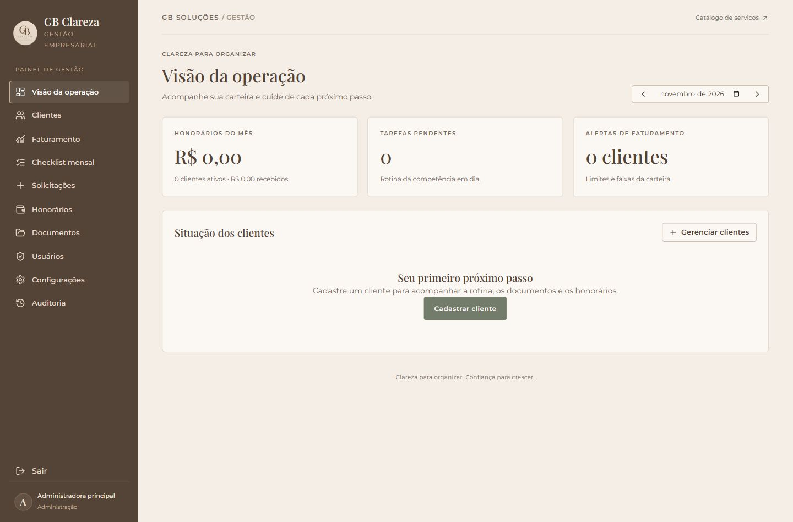
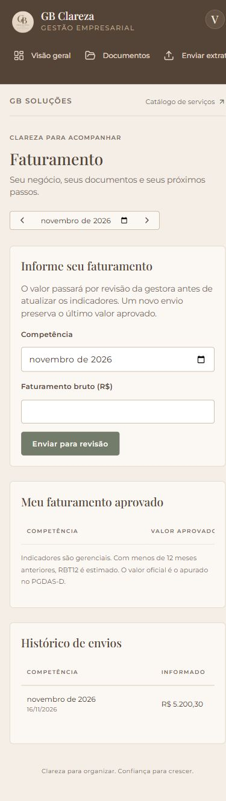

# Validação da atualização — 16/11/2026

- Redeploy de frontend e backend concluído com `docker compose up -d --build`. Ambos os containers estão saudáveis. Aplicação em http://localhost:3000; API sem porta publicada no host.
- `/api/health/ready` respondeu HTTP 200. CSP, proteção de enquadramento e `nosniff` conferidos.
- Quatro migrations aplicadas no schema `gb_clareza`, preservando o cadastro e o histórico existentes.
- **36 testes aprovados** no banco separado `gastomensal_test`: sessão, CSRF, perfis, isolamento entre clientes, convites e recuperação, faturamento, contratos históricos, concorrência, arquivos, cofre, certificados A1, Kanban, relatórios e fuso de São Paulo.
- Builds TypeScript e Docker concluídos. Auditoria das dependências de produção sem vulnerabilidades reportadas.
- Cofre testado com nova confirmação de senha, autorização por ficha, expiração, dados cifrados e ausência de segredos na listagem e auditoria. Certificado A1 descartável validado, cifrado no adaptador de teste e baixado com conteúdo idêntico.
- Navegador: login administrativo, ficha ampliada, abertura do cofre, movimento de cartão por arraste, apuração, geração e download de PDF, marca GB Soluções, CRC e WhatsApp. Layouts desktop e celular de 390 px conferidos.
- PDFs mensal e anual renderizados e inspecionados. Valores pendentes não entram nos relatórios; meses ausentes não viram zero. Documentação faltante mantém o documento como prévia. Relatórios anuais são apoio à DASN-SIMEI/DEFIS, sem transmissão oficial.
- Os dados temporários de cliente, solicitação, apuração e relatórios usados na conferência foram removidos. Cadastros reais preservados. O PDF temporário baixado também foi removido de Downloads.
- Backup cifrado da versão atual gerado e restaurado em banco separado. Contagens iguais na origem e destino: 1 cliente, 3 usuários, 8 planos, 13 serviços e 4 migrations. Estruturas novas conferidas; banco temporário removido após a comparação.

## Integrações e pendências conhecidas

**Resend:** remetente configurado como `GB Solucoes <contato@mail.luisbuscher.com.br>`. O provedor aceitou os dois convites que estavam na fila, sem erro de envio. Isso confirma aceitação pelo provedor, não chegada à caixa de entrada ou leitura. A tela distingue o estado de envio da senha ainda não definida.

**Endereço dos convites:** `APP_URL` permanece local. Links para `http://localhost:3000` só abrem neste computador. Acesso dos clientes pela internet requer domínio público HTTPS e configuração correspondente.

**GCS:** credenciais presentes, mas a conta de serviço recebeu HTTP 403 por ausência de `storage.buckets.get`. O usuário informou que ajustará depois. Documentos e certificados aguardam essa correção; nenhum upload foi marcado como concluído. A conta também precisa criar, ler e excluir objetos. A prevenção de acesso público deve continuar ativada.

**Relatórios:** download autenticado disponível mesmo com a cópia privada em nuvem pendente. O banco guarda versões e metadados, sem os binários PDF. Após corrigir o GCS, o processamento periódico tentará publicar as cópias pendentes.

HTTPS público, certificado do domínio, PostgreSQL remoto com TLS e cópias de backup em outro dispositivo dependem do ambiente de produção. O ambiente local usa HTTP no loopback e o PostgreSQL externo solicitado.

## Operação de backup

O backup automático instalado na entrega inicial permanece em modo usuário, com processo oculto e atalho na Inicialização. O Windows negou o registro de tarefa sem sessão aberta; a alternativa executa após as 03h de São Paulo enquanto houver sessão ativa e recupera a execução pendente ao entrar. Para funcionamento sem sessão aberta, é necessário registrar a tarefa com uma conta autorizada pelo Windows. Retenção local: 30 dias.

## Evidência visual

Quadro final após remover os registros temporários:

## Histórico da entrega inicial

- Frontend e backend compilados em TypeScript e executados em containers separados.
- `docker compose up -d --build` e reinício dos dois serviços concluídos; healthchecks saudáveis.
- Acesso local em http://localhost:3000; API sem porta publicada no host.
- Respostas HTTP conferidas com CSP, X-Frame-Options DENY, nosniff e política de referência; API pronta com HTTP 200.
- PostgreSQL externo local `gastomensal` criado sem modificar outros bancos. Três migrations aplicadas no schema `gb_clareza`.
- Administrador primário provisionado pelo `.env`, oito planos e 13 serviços cadastrados. Dados temporários de interface removidos.
- **25 testes de integração aprovados**, usando o banco separado `gastomensal_test`: sessões, CSRF, perfis, isolamento entre clientes, tokens, revisão de faturamento, contratos históricos, atualizações concorrentes, arquivos e migrations repetidas.
- Smoke test da aplicação publicada validou login, logout, novo login e oito módulos da API.
- `npm audit --omit=dev`: nenhuma vulnerabilidade reportada nas dependências de produção dos dois serviços. Os builds Docker também concluíram a auditoria sem vulnerabilidades reportadas.
- Navegador: login da gestora e cliente, cadastro, checklist persistido, envio de faturamento, aprovação pela gestora, configurações, layout desktop 1440 px e móvel 390 px; sem erros de console na conferência final.
- Backup AES-256-GCM gerado e restaurado em banco temporário. Contagens iguais na origem e destino: **0 clientes, 1 usuário, 8 planos, 13 serviços e 3 migrations**. Bancos temporários de restauração removidos após conferência.
- Backup automático instalado em **modo usuário**, com processo oculto e atalho na Inicialização. O Agendador do Windows negou o registro sem sessão aberta; a alternativa executa após as 03h de São Paulo enquanto houver sessão ativa e recupera execução pendente ao entrar. Log de execução confirmou saída 0.

### Dependências externas na entrega inicial

Na entrega inicial, GCS e Resend estavam sem credenciais reais. A situação atual consta acima. A suíte usa adaptadores somente em ambiente de teste e verifica a indisponibilidade explícita quando a configuração está vazia.

HTTPS público, certificado do domínio, PostgreSQL remoto com TLS, cópia de backups para outro dispositivo e política de retenção dos objetos GCS dependem do ambiente de produção. O ambiente entregue usa HTTP apenas no loopback e o PostgreSQL local solicitado.

### Evidências visuais da entrega inicial

O portal móvel foi fotografado durante o teste com dados temporários, posteriormente removidos. O painel desktop mostra o estado final, pronto para o primeiro cadastro.

